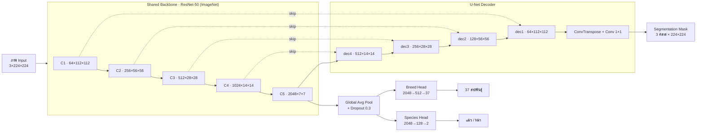
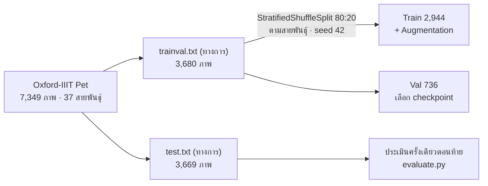
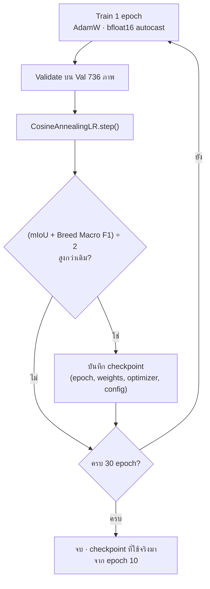
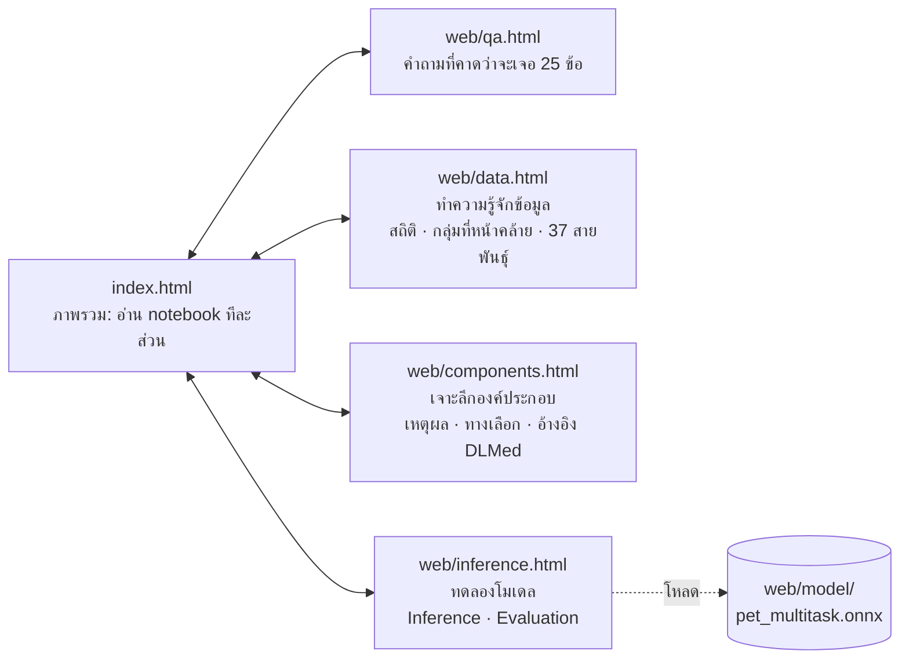
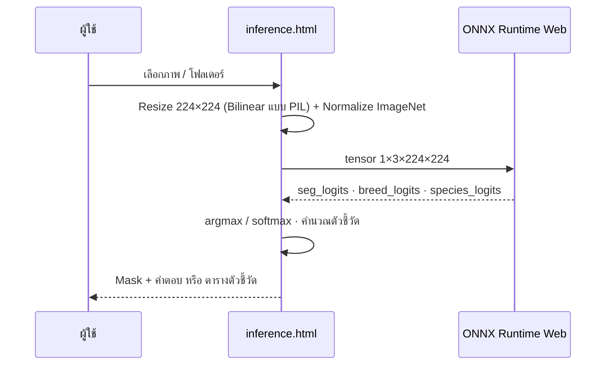
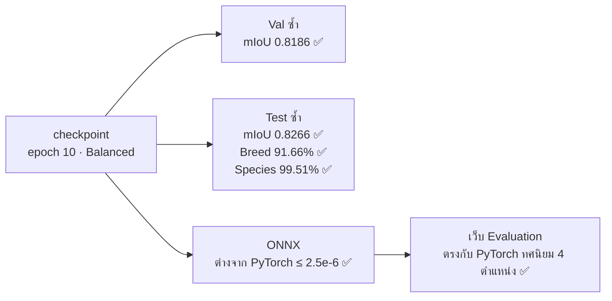

<div align="center">

# 🐾 Oxford-IIIT Pet Multi-task Learning

**Segmentation + Breed Classification + Species Classification ด้วย Multi-task ResNet-50**


[](https://drive.google.com/drive/folders/1sGyT1zmcHphF5UrKyR3yzPUSb8jOcf_1?usp=sharing)
[](https://drive.google.com/drive/folders/1-gLFBN5-i7dN8-7wchyqGQ55Kdez-0B5?usp=sharing)

</div>

---

## 📑 สารบัญ

1. [ภาพรวมโปรเจกต์](#-ภาพรวมโปรเจกต์)
2. [สถาปัตยกรรมโมเดล](#-สถาปัตยกรรมโมเดล)
3. [โครงสร้างโปรเจกต์](#-โครงสร้างโปรเจกต์)
4. [การติดตั้ง](#-การติดตั้ง)
5. [การดาวน์โหลดข้อมูล](#-การดาวน์โหลดข้อมูล)
6. [การดาวน์โหลดโมเดลที่เทรนแล้ว](#-การดาวน์โหลดโมเดลที่เทรนแล้ว)
7. [การเทรนโมเดล (Training)](#-การเทรนโมเดล-training)
8. [การประเมินผล (Evaluation)](#-การประเมินผลบนชุดทดสอบ-evaluation)
9. [การทดสอบกับภาพเดี่ยว (Inference)](#-การทดสอบกับภาพเดี่ยว-inference)
10. [ผลลัพธ์ที่ได้ (Outputs)](#-ผลลัพธ์ที่ได้-outputs)
11. [เอกสารเว็บแบบโต้ตอบ (Interactive Docs)](#-เอกสารเว็บแบบโต้ตอบ-interactive-docs)
12. [ทดลองโมเดลบนเบราว์เซอร์ (ONNX)](#-ทดลองโมเดลบนเบราว์เซอร์-onnx)
13. [ผลการตรวจทานงาน](#-ผลการตรวจทานงาน)
14. [บันทึกการเปลี่ยนแปลง](#-บันทึกการเปลี่ยนแปลง)

---

## 🎯 ภาพรวมโปรเจกต์

โปรเจกต์นี้พัฒนาโมเดล **Multi-task Learning** บนชุดข้อมูล **Oxford-IIIT Pet** (ภาพถ่ายสัตว์เลี้ยงทั้งหมด **7,349 ภาพ**) เพื่อทำ 3 งานพร้อมกันในโมเดลเดียว:

| งาน | รายละเอียด |
|---|---|
| 🖼️ **Segmentation** | แยกสัตว์เลี้ยงออกจากพื้นหลังระดับพิกเซล (Trimap 3 คลาส: Background / Pet / Boundary) |
| 🐶 **Breed Classification** | จำแนก **37 สายพันธุ์** |
| 🐱 **Species Classification** | จำแนก **แมว (Cat = 0)** หรือ **สุนัข (Dog = 1)** |

### ✨ จุดเด่น

- 🧩 **Shared Backbone** — ใช้ ResNet-50 ร่วมกันทุกงาน ลดความซ้ำซ้อนของพารามิเตอร์
- ⚖️ **ปรับน้ำหนัก Loss (λ) ได้** — เปรียบเทียบ 3 รูปแบบ: Balanced / Seg-focused / Cls-focused
- 🔒 **แยก Test Set ตาม Official Split + Stratified Train/Val Split (80:20)** — ป้องกัน Data Leakage
- 🔄 **Synchronized Augmentation** — ภาพและ Mask ถูกแปลงไปพร้อมกัน
- ⚡ **Training ที่ปรับจูนแล้ว** — bfloat16, AdamW, CosineAnnealingLR, cuDNN benchmark
- 📊 **ตัวชี้วัดครบถ้วน** — mIoU, Mean Dice, IoU รายคลาส, Precision, Recall, Macro F1, Accuracy, Confusion Matrix

> 📖 เหตุผลเบื้องหลังแต่ละข้อ เทียบกับเอกสารประกอบการสอน DLMed-08/10/12 และทางเลือกที่ไม่ได้เลือก อธิบายไว้ใน [`web/components.html`](web/components.html) (ดู[เอกสารเว็บแบบโต้ตอบ](#-เอกสารเว็บแบบโต้ตอบ-interactive-docs))

### 📈 ผลบน Unseen Test Set (3,669 ภาพ)

| งาน | ตัวชี้วัดหลัก | ค่า |
|---|---|:---:|
| Segmentation | mIoU / Mean Dice / IoU ตัวสัตว์ | 0.8266 / 0.8987 / 0.8964 |
| Breed (37 คลาส) | Accuracy / Macro F1 | 91.69% / 91.54% |
| Species (แมว/หมา) | Accuracy / Macro F1 | 99.51% / 99.44% |

---

## 🏗️ สถาปัตยกรรมโมเดล



| ส่วน | พารามิเตอร์ | สัดส่วน |
|---|---:|---:|
| Shared Backbone (ResNet-50) | 23,508,032 | 48.2% |
| U-Net Decoder | 23,965,123 | 49.1% |
| Breed + Species Heads | 1,330,599 | 2.7% |
| **รวม** | **48,803,754** | 100% |

**Loss Function** (`utils/losses.py`):

```
L_total = λ_seg × (CrossEntropy + Dice)                  ← Segmentation
        + λ_breed × CrossEntropy (Label Smoothing 0.05)  ← Breed
        + λ_species × CrossEntropy                       ← Species
```

ค่าเริ่มต้น: λ_seg = 1.0, λ_breed = 1.0, λ_species = 0.5

---

## 📁 โครงสร้างโปรเจกต์

```
oxford_pet_multitask/
│
├── configs/
│   ├── __init__.py
│   └── config.py                 # Hyperparameters, Path และสัดส่วนน้ำหนัก Loss (λ)
│
├── data/
│   ├── __init__.py
│   ├── class_mappings.py         # รายชื่อ 37 สายพันธุ์ + แปลง breed_id → species_id (Cat=0, Dog=1)
│   └── dataset.py                # โหลดข้อมูล, Stratified Split, Synchronized Augmentation
│
├── models/
│   ├── __init__.py
│   ├── backbone.py               # Shared ResNet-50 Encoder (ส่งออก Feature C1–C5)
│   ├── decoder.py                # U-Net Decoder พร้อม Skip Connections
│   └── multitask_model.py        # รวม Backbone + Decoder + Breed/Species Heads
│
├── utils/
│   ├── __init__.py
│   ├── losses.py                 # MultiTaskLoss (CE + Dice + Label Smoothing)
│   ├── metrics.py                # mIoU, Mean Dice, Macro F1, Precision, Recall, Accuracy
│   └── visualization.py          # วาดภาพเปรียบเทียบ Mask และ Confusion Matrix
│
├── data_cache/                   # 🚫 .gitignore — เก็บชุดข้อมูลต้นฉบับ
│   └── oxford-iiit-pet/
│       ├── images/               # ภาพสัตว์เลี้ยง 7,349 ภาพ (.jpg)
│       └── annotations/          # list.txt, trainval.txt, test.txt, xmls/, trimaps/
│
├── checkpoints/                  # 🚫 .gitignore — ไฟล์น้ำหนักโมเดล
│   ├── best_model_resnet50.pth
│   ├── best_model_resnet50_seg2.0_cls0.5.pth
│   └── best_model_resnet50_seg0.5_cls2.0.pth
│
├── outputs/                      # 🚫 .gitignore — กราฟและภาพสำหรับทำสไลด์
│
├── docs/
│   ├── Project 2 Instruction.pdf # โจทย์และเกณฑ์การให้คะแนน (มีฉบับ .png)
│   └── 625b755/                  # ผลตรวจทานรอบ commit 625b755
│       ├── REVIEW.md             # ผลตรวจทาน checkpoint และการเทียบกับเกณฑ์
│       └── DLMed-Project2-QA.pdf # บันทึกถาม-ตอบระหว่างการตรวจทาน
│
├── examples/                     # ตัวอย่างผลลัพธ์ที่รันแล้ว (เก็บเป็น .zip)
│   ├── outputs.zip               # ภาพทั้งหมดใน outputs/ จาก evaluate.py และ notebook
│   └── รายงานผลทดสอบ.zip          # ภาพผลทดสอบ, Inference 1–2, ตัวชี้วัด Train/Test
│
├── web/                          # 🌐 เอกสารเว็บแบบโต้ตอบ (เปิดได้โดยไม่ต้องมีเซิร์ฟเวอร์โมเดล)
│   ├── data.html                 # ทำความรู้จักข้อมูล: กราฟ, แคตตาล็อก 37 สายพันธุ์, สายพันธุ์นอกชุดข้อมูล
│   ├── components.html           # เจาะลึกเหตุผลของแต่ละองค์ประกอบ
│   ├── qa.html                   # คำถามที่คาดว่าจะเจอ 25 ข้อพร้อมแนวคำตอบ
│   ├── inference.html            # ทดลองโมเดล: Inference / Evaluation บนเบราว์เซอร์
│   ├── assets/                   # CSS, JS, ภาพประกอบ, ข้อมูลสายพันธุ์
│   └── model/                    # 🚫 .gitignore — pet_multitask.onnx (สร้างด้วย export_onnx.py)
│
├── index.html                    # 🌐 หน้าแรกของเอกสารเว็บ: อ่าน notebook ทีละส่วน
├── train.py                      # ฝึกสอนโมเดล
├── evaluate.py                   # ประเมินผลบน Unseen Test Set (3,669 ภาพ)
├── inference.py                  # ทำนายผลจากภาพเดี่ยว (แสดง Mask และ % ความมั่นใจ)
├── export_onnx.py                # แปลง checkpoint เป็น ONNX สำหรับหน้า web/inference.html
├── project_overview_and_presentation_guide (V.2).ipynb   # Code tour: รันวิเคราะห์ผลและไกด์ทำสไลด์ 10 แผ่น (ฉบับล่าสุด)
├── project_overview_and_presentation_guide.ipynb         # ฉบับก่อนหน้า
├── requirements.txt
├── .gitignore
└── README.md
```

> [!NOTE]
> ตั้งแต่มีเอกสารเว็บ **Notebook ทำหน้าที่เป็น code tour** (รันโค้ดจริงและสร้างภาพสำหรับสไลด์) ส่วน **เว็บทำหน้าที่เป็นเอกสารแบบโต้ตอบ** (อ่านง่าย มีคำอธิบายเชิงลึก และทดลองโมเดลได้)

---

## 🛠️ การติดตั้ง

เปิด Terminal หรือ Command Prompt ในโฟลเดอร์โปรเจกต์ แล้วทำตามขั้นตอน:

### 1️⃣ สร้างและเปิดใช้งาน Virtual Environment

```bash
python -m venv venv
```

```bash
# Windows
venv\Scripts\activate

# macOS / Linux
source venv/bin/activate
```

### 2️⃣ ติดตั้งไลบรารีที่จำเป็น

```bash
pip install --upgrade pip

# ติดตั้ง PyTorch (ตัวอย่างสำหรับ NVIDIA GPU / CUDA)
pip3 install torch torchvision --index-url https://download.pytorch.org/whl/cu132

# ติดตั้งไลบรารีอื่น ๆ
pip install -r requirements.txt
```

> [!NOTE]
> 💡 **ให้เลือกเวอร์ชัน PyTorch ให้สอดคล้องกับสเปกเครื่องของตัวเอง** (บรรทัด `pip3 install torch torchvision --index-url ...` ด้านบน)
> ดูตัวเลือกทั้งหมดได้ที่ [pytorch.org/get-started](https://pytorch.org/get-started/locally/)

### 📦 ไลบรารีหลักที่ใช้

| หมวด | ไลบรารี |
|---|---|
| Deep Learning & Augmentation | `torch>=2.4.0`, `torchvision>=0.19.0` (Augmentation ใช้ `torchvision.transforms`) |
| Evaluation & Computation | `numpy>=1.26.0`, `scikit-learn>=1.4.0`, `pandas>=2.0.0` |
| Visualization | `matplotlib>=3.8.0`, `seaborn>=0.13.0` |
| Notebook | `jupyter` (สำหรับเปิด `project_overview_and_presentation_guide.ipynb`) |

---

## 📥 การดาวน์โหลดข้อมูล

📂 **ดาวน์โหลดข้อมูลได้ที่:** [Google Drive](https://drive.google.com/drive/folders/1sGyT1zmcHphF5UrKyR3yzPUSb8jOcf_1?usp=sharing)

> [!TIP]
> 📦 สามารถดาวน์โหลดเป็นไฟล์ **`.zip`** หรือ **`.rar`** ก็ได้ (เลือกแบบที่สะดวก)

หลังดาวน์โหลดและแตกไฟล์ ให้วางข้อมูลตามโครงสร้างนี้:

```
data_cache/
└── oxford-iiit-pet/
    ├── images/
    └── annotations/
```

> [!TIP]
> แหล่งต้นฉบับ: [Oxford VGG · The Oxford-IIIT Pet Dataset](https://www.robots.ox.ac.uk/~vgg/data/pets/) (`images.tar.gz` ~790 MB และ `annotations.tar.gz` ~19 MB) แตกไฟล์ทั้งสองไว้ใน `data_cache/oxford-iiit-pet/` จะได้โครงสร้างเดียวกัน

การแบ่งข้อมูลที่ `data/dataset.py` ทำให้อัตโนมัติ:



ดูสถิติข้อมูลและลักษณะเด่นของทั้ง 37 สายพันธุ์ได้ที่ [`web/data.html`](web/data.html)

---

## 🤖 การดาวน์โหลดโมเดลที่เทรนแล้ว

หากไม่ต้องการเทรนเอง สามารถดาวน์โหลดไฟล์น้ำหนักโมเดล (`.pth`) ที่เทรนเสร็จแล้วได้ที่:

📂 **ดาวน์โหลดโมเดลได้ที่:** [Google Drive](https://drive.google.com/drive/folders/1-gLFBN5-i7dN8-7wchyqGQ55Kdez-0B5?usp=sharing)

วางไฟล์ไว้ในโฟลเดอร์ `checkpoints/`:

```
checkpoints/
└── best_model_resnet50.pth
```

> [!IMPORTANT]
> ⭐ โมเดลที่ใช้จริงในการ **Inference** คือ **`best_model_resnet50.pth`** (รูปแบบหลัก Balanced Multi-task)

---

## 🚀 การเทรนโมเดล (Training)

มี 3 รูปแบบให้เลือก โดยปรับสัดส่วนน้ำหนัก Loss ระหว่างงาน Segmentation (λ_seg) และ Breed Classification (λ_breed):

| รูปแบบ | λ_seg | λ_breed | คำสั่ง | ไฟล์ที่บันทึก |
|---|:---:|:---:|---|---|
| ⚖️ **Balanced** (หลัก) | 1.0 | 1.0 | `python train.py` | `best_model_resnet50.pth` |
| 🎯 **Seg-focused** (เปรียบเทียบที่ 1) | 2.0 | 0.5 | `python train.py --w_seg 2.0 --w_breed 0.5` | `best_model_resnet50_seg2.0_cls0.5.pth` |
| 🏷️ **Cls-focused** (เปรียบเทียบที่ 2) | 0.5 | 2.0 | `python train.py --w_seg 0.5 --w_breed 2.0` | `best_model_resnet50_seg0.5_cls2.0.pth` |

```bash
# รูปแบบหลัก
python train.py

# รูปแบบเปรียบเทียบที่ 1: เน้น Segmentation
python train.py --w_seg 2.0 --w_breed 0.5

# รูปแบบเปรียบเทียบที่ 2: เน้น Classification
python train.py --w_seg 0.5 --w_breed 2.0
```

> ไฟล์น้ำหนักทั้งหมดจะถูกบันทึกไว้ในโฟลเดอร์ `checkpoints/`

**ผลของทั้ง 3 รูปแบบ** (ตรวจซ้ำจาก checkpoint จริงบนภาพชุดเดียวกัน · รายละเอียดและการทดสอบนัยสำคัญใน [`docs/625b755/REVIEW.md`](docs/625b755/REVIEW.md)):

| รูปแบบ | epoch ที่เลือก | Val (mIoU + F1) ÷ 2 | Test mIoU | Test Breed Acc | Test Species Acc |
|---|:---:|:---:|:---:|:---:|:---:|
| ⚖️ Balanced (หลัก) | 10 | **0.8863** | **0.8266** | 91.66% | 99.51% |
| 🎯 Seg-focused | 28 | 0.8832 | 0.8234 | 92.64% | 99.78% |
| 🏷️ Cls-focused | 27 | 0.8842 | 0.8222 | **93.08%** | **99.81%** |

> [!WARNING]
> ตัวเลขของ Seg-focused และ Cls-focused ในเซลล์ที่ 6 ของ notebook **ไม่ตรง** กับ checkpoint ที่แจกจ่าย และ checkpoint ถูกเลือกต่าง epoch กัน (10 vs 27–28) จึงยังแยกผลของ λ ออกจากผลของการเลือก epoch ไม่ได้ Balanced ยังเป็นแบบหลักเพราะได้คะแนนสูงสุดบน Val ซึ่งเป็นเกณฑ์ที่กำหนดไว้ก่อน

ขั้นตอนในแต่ละ epoch ของ `train.py`:



---

## 📊 การประเมินผลบนชุดทดสอบ (Evaluation)

ประเมินโมเดลบน **Unseen Test Set (3,669 ภาพ)**:

```bash
python evaluate.py
```

สิ่งที่ได้จากการรัน:

- ตัวชี้วัดแยกตามงาน: **mIoU, Mean Dice** (Segmentation) และ **Accuracy, Precision, Recall, Macro F1** (Classification)
- ภาพตัวอย่างผล Segmentation
- Confusion Matrix ของ Breed (37 สายพันธุ์) และ Species (Cat vs Dog)

---

## 🔍 การทดสอบกับภาพเดี่ยว (Inference)

ทดสอบการทำนายกับภาพภายนอก โดยแสดงทั้ง **Segmentation Mask** และ **% ความมั่นใจ** ของการจำแนก

> 📌 ก่อนรัน ตรวจสอบว่ามีไฟล์ `checkpoints/best_model_resnet50.pth` แล้ว (เทรนเอง หรือ [ดาวน์โหลดโมเดล](#-การดาวน์โหลดโมเดลที่เทรนแล้ว))

```bash
python inference.py sample_dog.jpg
python inference.py "path/to/your_pet_photo.jpg"
```

> 💡 ภาพตัวอย่างผล Inference ที่รันไว้แล้วอยู่ใน `examples/รายงานผลทดสอบ.zip` (`Inference 1.png`, `Inference 2.png`) หากไม่ต้องการติดตั้ง Python ใช้หน้า [ทดลองโมเดลบนเบราว์เซอร์](#-ทดลองโมเดลบนเบราว์เซอร์-onnx) แทนได้

---

## 🖼️ ผลลัพธ์ที่ได้ (Outputs)

ไฟล์ภาพทั้งหมดถูกเก็บไว้ในโฟลเดอร์ `outputs/`:

| ไฟล์ | แหล่งที่มา | คำอธิบาย |
|---|---|---|
| `test_seg_example_1..5.png` | `evaluate.py` | ผลลัพธ์ Segmentation บน Test Set |
| `breed_confusion_matrix.png` | `evaluate.py` | Heatmap 37 สายพันธุ์ |
| `species_confusion_matrix.png` | `evaluate.py` | Heatmap Cat vs Dog |
| `slide_dataset_samples.png` | Notebook | ตัวอย่าง Dataset + Ground Truth Trimap (300 DPI) |
| `slide_learning_curves.png` | Notebook | กราฟ Loss และ mIoU/F1 ตลอด 30 Epochs (300 DPI) |
| `slide_confusion_matrices.png` | Notebook | Confusion Matrix คู่ขนาน (300 DPI) |
| `slide_good_vs_error_cases.png` | Notebook | วิเคราะห์ Good Cases vs Error Cases (300 DPI) |

> 📓 รายละเอียดการวิเคราะห์ผลและไกด์ไลน์ทำสไลด์ 10 แผ่น ดูได้ใน `project_overview_and_presentation_guide (V.2).ipynb` · ตัวอย่างไฟล์ทั้งหมดที่รันแล้วอยู่ใน `examples/outputs.zip`

---

## 🌐 เอกสารเว็บแบบโต้ตอบ (Interactive Docs)

เปิด `index.html` ด้วยเบราว์เซอร์ได้ทันที (ดับเบิลคลิก) ทุกหน้าเป็นไฟล์ static ไม่ต้องมีเซิร์ฟเวอร์ ยกเว้นการโหลดโมเดลอัตโนมัติในหน้าทดลองโมเดล · สูตรคณิตศาสตร์บนเว็บแสดงด้วย [KaTeX](https://katex.org/) (README ไม่ใช้ TeX เพื่อให้อ่านบน GitHub Mobile ได้) · ลิงก์ภายนอกทุกลิงก์มีเครื่องหมาย ↗



| หน้า | เนื้อหา | ใช้ตอนไหน |
|---|---|---|
| `index.html` | อธิบาย notebook ทีละเซลล์ด้วยภาษาง่าย | ทำความเข้าใจภาพรวมก่อนทำสไลด์ |
| `web/data.html` | กราฟจำนวนภาพ ขนาดภาพ สัดส่วนพิกเซล ผลรายสายพันธุ์ (F1 vs Pet IoU) คู่ที่สับสน · แคตตาล็อก 37 สายพันธุ์ (กดดูรายละเอียดด้านข้าง) · สายพันธุ์นอกชุดข้อมูลที่หน้าคล้าย 23 สายพันธุ์ พร้อมแหล่งอ้างอิง | สไลด์ Dataset และ Error Analysis |
| `web/components.html` | 10 องค์ประกอบ: เลือกอะไร ทำไม เอกสาร DLMed หน้าไหนรองรับ ทางเลือกที่ไม่ได้เลือก และคำถามที่อาจโดนถาม · อธิบายจุดเด่นทั้ง 6 ข้อใน README | สไลด์ Architecture, Loss, Training |
| `web/qa.html` | **คำถามที่คาดว่าจะเจอ 25 ข้อ** ใน 5 หมวด พร้อมแนวคำตอบและเคล็ดลับ | ซ้อมตอบคำถาม |
| `web/inference.html` | ทดลองโมเดลบนเบราว์เซอร์ 2 โหมด (ปุ่ม **▶ ทดลองโมเดล** ขวาสุดของแถบเมนู) | สาธิตสดตอนนำเสนอ |

---

## 🧪 ทดลองโมเดลบนเบราว์เซอร์ (ONNX)

หน้า `web/inference.html` รันโมเดลในเบราว์เซอร์ด้วย [ONNX Runtime Web](https://onnxruntime.ai/docs/tutorials/web/) (WebGPU หรือ WebAssembly) ภาพไม่ถูกส่งออกจากเครื่อง

| โหมด | อินพุต | ผลลัพธ์ |
|---|---|---|
| **Inference** | ภาพ 1 ภาพจากเครื่อง (ลากวางได้) | Mask ซ้อนบนภาพ / Mask / ตัดพื้นหลัง, หมาหรือแมว + ความมั่นใจ, สายพันธุ์ 5 อันดับ, คำเตือนเมื่อสองหัวตอบขัดกัน |
| **Evaluation** | โฟลเดอร์ `oxford-iiit-pet/` (หรือโฟลเดอร์ภาพที่ตั้งชื่อ `สายพันธุ์_เลข.jpg`) | mIoU, Dice, IoU รายคลาส, Accuracy, Macro P/R/F1, Confusion Matrix 37×37, คู่ที่สับสน, ผลรายสายพันธุ์, CSV รายภาพ |

**ขั้นตอน:**

```bash
# 1) แปลงโมเดล (ครั้งเดียว) → web/model/pet_multitask.onnx (~186 MB)
pip install onnx onnxscript onnxruntime
python export_onnx.py

# 2) เปิดเว็บเซิร์ฟเวอร์ไฟล์ธรรมดาที่โฟลเดอร์โปรเจกต์ แล้วเปิด http://localhost:8000/web/inference.html
python -m http.server 8000
```

หรือดับเบิลคลิก `web/inference.html` แล้วกด **"เลือกไฟล์โมเดล"** ชี้ไปที่ไฟล์ `.onnx` (หน้า `file://` โหลดไฟล์เองอัตโนมัติไม่ได้)



> [!NOTE]
> ต้องต่ออินเทอร์เน็ตครั้งแรกเพื่อโหลดไลบรารี onnxruntime-web และฟอนต์จาก CDN · ค่าตัวชี้วัดในเบราว์เซอร์อาจต่างจาก `evaluate.py` เล็กน้อย เพราะตัวถอดรหัส JPEG ต่างกัน · WASM บน CPU ช้า (ราว 1–3 วินาทีต่อภาพ) แนะนำให้ตั้งจำกัดจำนวนภาพเมื่อประเมินทั้งชุด

---

## ✅ ผลการตรวจทานงาน

ตรวจ `best_model_resnet50.pth` และรันประเมินซ้ำบน Val และ Test (รายละเอียดใน [`docs/625b755/REVIEW.md`](docs/625b755/REVIEW.md))



| เรื่อง | ผล |
|---|---|
| Checkpoint ตรงกับที่รายงาน | ✅ epoch 10, config Balanced, ตัวเลข test ทำซ้ำได้ (Breed ต่าง 1 ภาพจาก CPU vs GPU) |
| เกณฑ์ Multi-task / ข้อมูล / การประเมิน | ✅ ครบ |
| เกณฑ์ "เปรียบเทียบอย่างน้อย 3 รูปแบบ" | ⚠️ ตรวจซ้ำได้ครบ 3 แบบแล้ว แต่ตัวเลขของ 2 แบบไม่ตรงกับ notebook (ทั้งสองจำแนกเก่งกว่า Balanced 1.0–1.4 จุด มีนัยสำคัญ และ mIoU ต่ำกว่า 0.003–0.004) และ epoch ที่เลือกต่างกัน · แนะนำให้เทียบที่ epoch เดียวกัน หรือเพิ่ม ResNet-34 / single-task baseline |
| ข้อสรุป Sphynx → Chihuahua ใน notebook 4.1 | ⚠️ ไม่ถูกต้อง: หัวหมาแมวก็ตอบ "หมา" ด้วยใน 10 จาก 12 ภาพ สองหัวขัดกันจริงแค่ 10 ภาพทั้งชุด |
| ข้อสังเกตเชิง implement | 8 ข้อ ไม่มีข้อใดทำให้ตัวเลขที่รายงานผิด (เช่น การเลือก checkpoint ไวต่อสัญญาณรบกวน, `inference.py` ไม่จัดการ EXIF) |

---

## 📝 บันทึกการเปลี่ยนแปลง

### 2026-10-16 (รอบ 3) · ตรวจ checkpoint ของ Seg-focused และ Cls-focused

- ประเมินทั้ง 3 รูปแบบบนภาพ Val และ Test ชุดเดียวกัน พร้อมทดสอบแบบจับคู่ (McNemar สำหรับ Breed, bootstrap 95% CI สำหรับ mIoU)
- พบว่าตัวเลข 2 รูปแบบในเซลล์ที่ 6 ของ notebook ไม่ตรงกับ checkpoint และข้อสรุป "เน้นงานไหน งานนั้นดีขึ้น" ไม่เป็นจริงกับไฟล์ชุดนี้
- อัปเดต `docs/625b755/REVIEW.md`, ตาราง λ ใน `web/components.html`, คำตอบใน `web/qa.html` และตารางผลด้านบน

### 2026-10-16 (รอบ 2) · ปรับเอกสารเว็บตามความเห็น

- **ย้ายคำถามที่คาดว่าจะเจอไปหน้าใหม่ `web/qa.html`** — มีสารบัญรายหมวด ปุ่มเปิด/ปิดทุกข้อ และลิงก์ภายนอก
- **แถบเมนู** — ปุ่ม **▶ ทดลองโมเดล** เด่นและอยู่ขวาสุด, ปุ่มสลับธีมเป็นไอคอน
- **`web/data.html` ปรับใหม่** — แคตตาล็อกเป็นภาพย่อพร้อมชื่อและ F1 กดแล้วรายละเอียดเปิดด้านข้าง, เพิ่มกราฟ 6 ชิ้น (มี tooltip และมุมมองตาราง), เพิ่มสายพันธุ์นอกชุดข้อมูลที่หน้าคล้าย 23 สายพันธุ์ (รวมสายพันธุ์ไทย 4 สายพันธุ์), ทุกสายพันธุ์มีแหล่งอ้างอิง AKC/UKC/CFA และ Wikipedia ที่ตรวจลิงก์แล้ว
- **`web/inference.html`** — ส่วนทดลองโมเดลขึ้นก่อน คำแนะนำการติดตั้งย้ายไปด้านล่าง
- **`web/components.html`** — สูตรแสดงด้วย KaTeX และลิงก์งานวิจัยทุกชิ้นไปยัง arXiv/DOI

### 2026-10-16 · เอกสารเว็บแบบโต้ตอบ และการตรวจทาน

- **เพิ่ม `.gitignore`** — ไม่รวม venv, ชุดข้อมูล, checkpoint (`*.pth`), โมเดล ONNX และ `outputs/` · ไฟล์ `.zip` ใน `examples/` ยังถูกเก็บไว้ตามเดิม
- **แยก `index.html` ออกเป็นหลายไฟล์** — ย้าย CSS ไป `web/assets/site.css` และภาพ base64 ไป `web/assets/img/` (เนื้อหาเดิมไม่เปลี่ยน) เพิ่มแถบเมนูด้านบนและปุ่มสลับโหมดมืด/สว่าง
- **เพิ่มหัวข้อ "คำถามที่คาดว่าจะเจอ"** ท้าย `index.html` — 25 คำถามใน 5 หมวด พร้อมแนวคำตอบและเคล็ดลับ
- **เพิ่ม `web/data.html`** — ทำความรู้จักข้อมูลและลักษณะเด่นของ 37 สายพันธุ์ พร้อมผลรายสายพันธุ์
- **เพิ่ม `web/components.html`** — เหตุผลของแต่ละองค์ประกอบเทียบกับเอกสาร DLMed-08/10/12 และอธิบาย "จุดเด่น" ทั้ง 6 ข้อ
- **เพิ่ม `web/inference.html` + `export_onnx.py`** — ทดลองโมเดลบนเบราว์เซอร์ โหมด Inference และ Evaluation
- **เพิ่ม `docs/625b755/REVIEW.md`** — ผลตรวจ checkpoint, รันประเมินซ้ำ และเทียบกับเกณฑ์การให้คะแนน
- **ปรับ README** — แผนภาพเป็น Mermaid, โครงสร้างโปรเจกต์ใหม่, แก้ badge Albumentations เป็น torchvision (โค้ดใช้ `torchvision.transforms`), แก้ตัวอย่างคำสั่ง inference ที่อ้างถึงโฟลเดอร์ที่ไม่มีแล้ว

---

<div align="center">

⭐ **Oxford-IIIT Pet Multi-task Learning** ⭐

</div>
